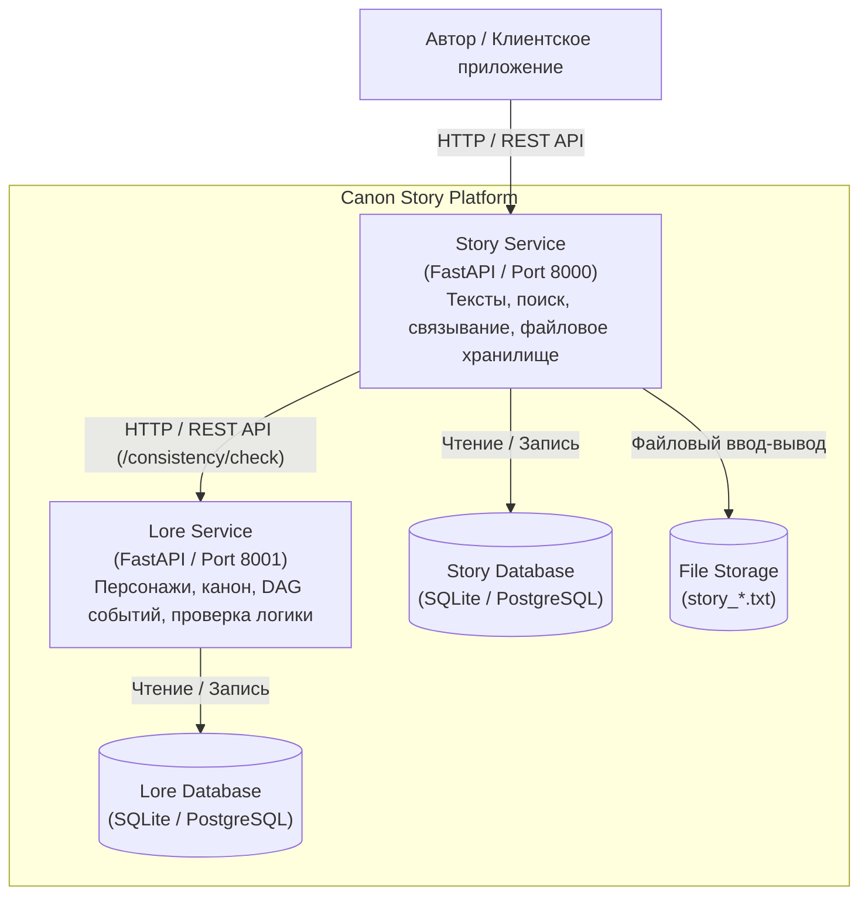
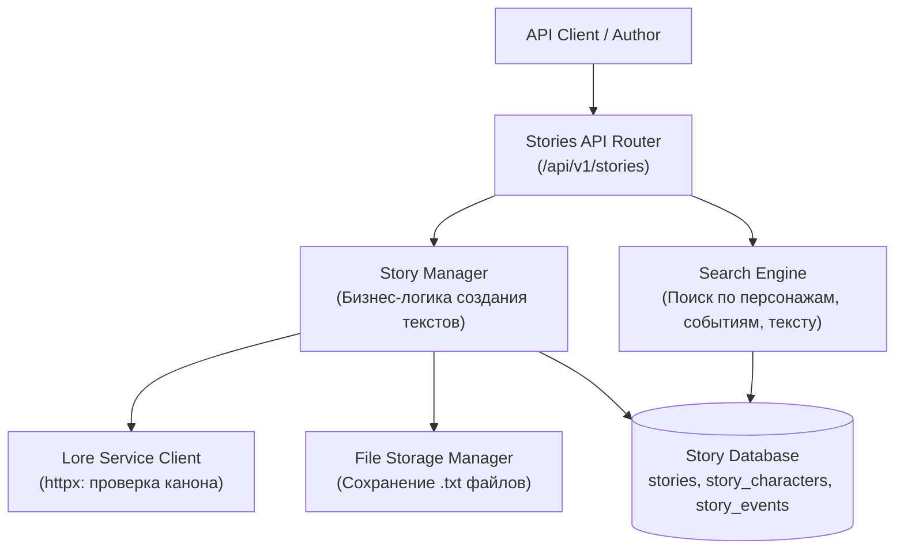
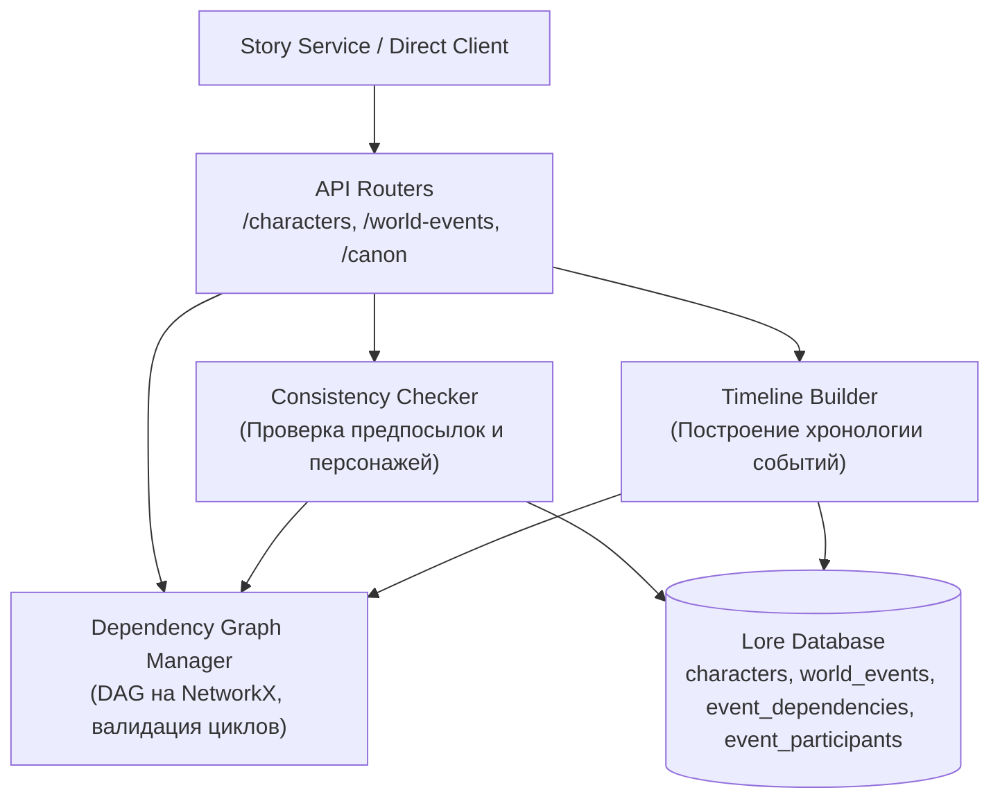

# Canon Story Engine (Lore & Story Microservices)

Микросервисная система для писателей и создателей авторских миров, решающая задачу структурирования текстов, контроля канона и проверки причинно-следственных связей между сюжетными событиями.

---

## 🏛️ Архитектура C4

### Уровень 2: Контейнеры (C4 Level 2 — Containers)



---

### Уровень 3: Компоненты Story Service (C4 Level 3 — Components)



---

### Уровень 3: Компоненты Lore Service (C4 Level 3 — Components)



---

## 📋 Соответствие требованиям проекта

1. **Линтеры (Анализаторы кода):**
   * **Ruff** (проверка правил `E`, `W`, `F`, `I` [isort], `B` [bugbear], `UP` [pyupgrade], `SIM` [simplify], `ARG` [unused arguments]).
   * **Mypy** (строгая статическая типизация с флагами `disallow_untyped_defs = true`, `check_untyped_defs = true`, `no_implicit_optional = true`).
2. **Code Style Fixer:**
   * **Black** + **Ruff Formatter** (единый стиль, длина строки 100 символов).
3. **Unit и Интеграционные тесты:**
   * **Pytest** + **pytest-asyncio** + **httpx**.
   * Покрытие:
     * Граф зависимостей (ацикличность, топологическая сортировка, обнаружение циклов).
     * API Lore Service (CRUD персонажей, события, проверка консистентности).
     * API Story Service (сохранение текстов на диск, поиск по персонажам и тексту).
     * Сквозной интеграционный тест взаимодействия микросервисов (`test_end_to_end_microservices_workflow`).
4. **Git Hooks:**
   * **pre-commit** с хуками:
     * `trailing-whitespace`, `end-of-file-fixer`, `check-yaml`, `check-added-large-files`
     * `black` (автоформатирование)
     * `ruff` (автофикс и валидация линтером)
     * `mypy` (проверка типов)
     * `pre-push` (автозапуск unit-тестов перед отправкой коммитов).
5. **API Design Guide (ENSI):**
   * Множественное число сущностей в URL: `/api/v1/characters`, `/api/v1/world-events`, `/api/v1/stories`.
   * Именование в `kebab-case`.
   * Формат фильтрации параметров: `filter[type]`, `filter[character_id]`, `filter[role]`, `filter[q]`.
   * Формат пагинации: `page[number]`, `page[size]` со структурой ответа `{"data": [...], "meta": {"current_page": 1, "per_page": 20, "total": N}}`.
   * Обработка ошибок по стандарту **RFC 7807 Problem Details** (`title`, `status`, `detail`, `instance`).
   * Правильное использование HTTP-статусов: `201 Created`, `200 OK`, `400 Bad Request`, `404 Not Found`, `409 Conflict`, `502 Bad Gateway`.

---

## 🚀 Инструкция по запуску

### 1. Подготовка окружения

Требуется **Python 3.11+**.

```powershell
# Создание виртуального окружения
python -m venv .venv

# Активация виртуального окружения (Windows PowerShell)
.venv\Scripts\Activate.ps1

# Установка всех зависимостей
pip install -r requirements-dev.txt
```

### 2. Установка Git Hooks

```powershell
pre-commit install --hook-type pre-commit --hook-type pre-push
```

### 3. Проверка качества кода

```powershell
# Запуск линтеров и форматтеров на всех файлах
pre-commit run --all-files

# Запуск тестов
pytest -v
```

---

## 🏃 Запуск микросервисов

### Запуск Lore Service (Сервис канона, порт 8001)

```powershell
$env:PYTHONPATH="services/lore_service"
uvicorn lore_app.main:app --port 8001 --reload
```
* **Swagger UI:** [http://127.0.0.1:8001/docs](http://127.0.0.1:8001/docs)

### Запуск Story Service (Сервис историй, порт 8000)

```powershell
$env:PYTHONPATH="services/story_service"
uvicorn story_app.main:app --port 8000 --reload
```
* **Swagger UI:** [http://127.0.0.1:8000/docs](http://127.0.0.1:8000/docs)

---

## 📖 Сценарий использования (Пример работы)

### 1. Регистрация персонажей в Lore Service
```http
POST http://127.0.0.1:8001/api/v1/characters
Content-Type: application/json

{"name": "Фальк", "type": "COMPANION", "description": "Спутник-андроид"}
```

```http
POST http://127.0.0.1:8001/api/v1/characters
Content-Type: application/json

{"name": "Конрад", "type": "NPC", "description": "Создатель"}
```

### 2. Создание событий канона и зависимостей в Lore Service
```http
POST http://127.0.0.1:8001/api/v1/world-events
Content-Type: application/json

{
  "title": "Фальк присоединился к отряду",
  "type": "COMPANION_JOIN",
  "participants": [{"character_id": 1, "role": "PARTICIPANT"}]
}
```

```http
POST http://127.0.0.1:8001/api/v1/world-events
Content-Type: application/json

{
  "title": "Конрад впервые появился",
  "type": "NPC_APPEAR",
  "participants": [{"character_id": 2, "role": "PARTICIPANT"}]
}
```

```http
POST http://127.0.0.1:8001/api/v1/world-events
Content-Type: application/json

{
  "title": "Раскрыта правда о происхождении Фалька",
  "type": "REVELATION",
  "parent_ids": [1, 2],
  "participants": [
    {"character_id": 1, "role": "PARTICIPANT"},
    {"character_id": 2, "role": "PARTICIPANT"}
  ]
}
```

### 3. Добавление текста в Story Service с автоматической проверкой канона

Если автор загружает текст, где раскрывается правда, но не указано появление Конрада:
```http
POST http://127.0.0.1:8000/api/v1/stories
Content-Type: application/json

{
  "title": "Неожиданное откровение",
  "character_ids": [1],
  "events": [
    {"event_id": 1, "role": "REQUIRES"},
    {"event_id": 3, "role": "CREATES"}
  ]
}
```

**Ответ Story Service (текст сохраняется, но возвращаются предупреждения канона):**
```json
{
  "id": 1,
  "title": "Неожиданное откровение",
  "warnings": [
    {
      "code": "MISSING_PREREQUISITES",
      "event_id": 3,
      "event_title": "Раскрыта правда о происхождении Фалька",
      "message": "For event 'Раскрыта правда о происхождении Фалька', the following canon prerequisites are not satisfied in requirements: Конрад впервые появился",
      "missing_prerequisites": ["Конрад впервые появился"]
    },
    {
      "code": "UNMENTIONED_EVENT_PARTICIPANT",
      "event_id": 3,
      "character_id": 2,
      "message": "Event 'Раскрыта правда о происхождении Фалька' involves character 'Конрад', but this character is not marked as participating in this story."
    }
  ]
}
```
