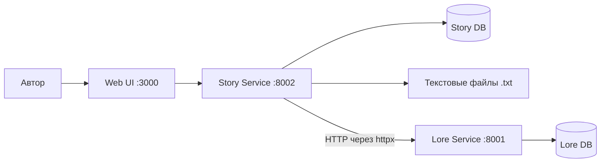

# StoryPlotter

**StoryPlotter** — приложение для авторов, которое помогает хранить тексты историй, вести канон вымышленного мира и проверять логическую согласованность сюжетных событий.

Проект состоит из двух REST API микросервисов и веб-интерфейса:

- **Lore Service** — персонажи, события мира, причинно-следственные зависимости, хронология и проверка канона.
- **Story Service** — создание и редактирование историй, хранение текстов в `.txt`, поиск и связь историй с персонажами и событиями канона.
- **Web UI** — браузерный интерфейс для работы с обоими сервисами.

## Содержание

- [Архитектура и технологии](#архитектура-и-технологии)
- [Взаимодействие сервисов](#взаимодействие-сервисов)
- [Требования](#требования)
- [Установка и запуск](#установка-и-запуск)
- [Переменные окружения](#переменные-окружения)
- [API и документация](#api-и-документация)
- [Формат ответов API](#формат-ответов-api)
- [Тестирование и качество кода](#тестирование-и-качество-кода)
- [Структура проекта](#структура-проекта)
- [Контакты и поддержка](#контакты-и-поддержка)

## Архитектура и технологии

### Компоненты

| Компонент | Технологии | Назначение |
|---|---|---|
| Lore Service | Python, FastAPI, Pydantic, SQLAlchemy Async, NetworkX | Управление каноном, персонажами, событиями и DAG зависимостей |
| Story Service | Python, FastAPI, Pydantic, SQLAlchemy Async, httpx | Управление историями, текстовыми файлами, поиском и интеграцией с Lore Service |
| Web UI | HTML, CSS, JavaScript | Пользовательский интерфейс |
| Хранилище данных | SQLite по умолчанию; конфигурация SQLAlchemy также допускает PostgreSQL через соответствующий async-драйвер | Раздельное хранение данных сервисов |

### Архитектурная схема



Lore Service строит ориентированный ациклический граф (DAG) зависимостей событий. На его основе формируется хронологический порядок и выполняется проверка предпосылок событий и участия персонажей.

Story Service связывает истории с персонажами и событиями Lore Service. При создании или обновлении истории сервис обращается к Lore Service для проверки канонической согласованности. Предупреждения проверки возвращаются в ответе истории.

### Внешние сервисы

Для работы приложения обязательные внешние SaaS-сервисы, Redis, Kafka или S3 не используются. Межсервисное взаимодействие выполняется по HTTP. Тексты сохраняются в локальном файловом хранилище.

## Взаимодействие сервисов

- Web UI обращается к Story Service и Lore Service по HTTP.
- Story Service обращается к Lore Service через HTTP-клиент `httpx` для проверки канона.
- У каждого микросервиса собственная база данных и собственная конфигурация подключения.
- Для передачи контекста трассировки поддерживается заголовок W3C `traceparent`.

## Требования

- Python **3.11 или новее**.
- `pip`.
- Windows, Linux или macOS.

## Установка и запуск

Все команды ниже приведены для PowerShell. Запуск через Docker Compose в текущей версии не предусмотрен как основной сценарий.

### 1. Получение проекта и виртуальное окружение

```powershell
git clone <URL-репозитория>
cd StoryPlotter
python -m venv .venv
.venv\Scripts\Activate.ps1
```

В Linux/macOS активация окружения:

```bash
source .venv/bin/activate
```

### 2. Установка зависимостей

```bash
python -m pip install --upgrade pip
pip install -r requirements-dev.txt
```

### 3. Запуск всего приложения

Из корневой папки проекта выполните:

```powershell
python run_app.py
```

Скрипт запускает оба FastAPI-сервиса и статический сервер веб-интерфейса, затем открывает UI в браузере.

| Компонент | Адрес |
|---|---|
| Web UI | http://127.0.0.1:3000 |
| Story Service | http://127.0.0.1:8002 |
| Lore Service | http://127.0.0.1:8001 |

### 4. Раздельный запуск

Если требуется запустить сервисы отдельно, откройте для каждого отдельный терминал из корня проекта.

**Lore Service:**

```powershell
$env:PYTHONPATH="services/lore_service"
uvicorn lore_app.main:app --host 127.0.0.1 --port 8001 --reload
```

**Story Service:**

```powershell
$env:PYTHONPATH="services/story_service"
uvicorn story_app.main:app --host 127.0.0.1 --port 8002 --reload
```

**Web UI:**

```powershell
python run_app.py
```

> `run_app.py` запускает все три процесса одновременно. Если микросервисы уже запущены вручную, не запускайте второй экземпляр `run_app.py`, чтобы избежать повторного запуска серверов на тех же портах.

## Переменные окружения

Настройки задаются через `.env` в корне проекта или переменные окружения. Для Lore Service используется префикс `LORE_`, для Story Service — `STORY_`. Необязательные параметры имеют значения по умолчанию.

| Переменная | Сервис | Значение по умолчанию | Назначение |
|---|---|---|---|
| `LORE_APP_NAME` | Lore | `Lore Service` | Название сервиса |
| `LORE_API_V1_STR` | Lore | `/api/v1` | Префикс API |
| `LORE_DATABASE_URL` | Lore | `sqlite+aiosqlite:///./lore.db` | URL базы данных |
| `LORE_DEBUG` | Lore | `false` | Флаг отладки |
| `STORY_APP_NAME` | Story | `Story Service` | Название сервиса |
| `STORY_API_V1_STR` | Story | `/api/v1` | Префикс API |
| `STORY_DATABASE_URL` | Story | `sqlite+aiosqlite:///./stories.db` | URL базы данных |
| `STORY_LORE_SERVICE_URL` | Story | `http://127.0.0.1:8001` | Адрес Lore Service |
| `STORY_STORAGE_DIR` | Story | `./storage/texts` | Каталог текстовых файлов |
| `STORY_DEBUG` | Story | `false` | Флаг отладки |

Пример `.env` для локального запуска с настройками по умолчанию:

```dotenv
LORE_DATABASE_URL=sqlite+aiosqlite:///./lore.db
STORY_DATABASE_URL=sqlite+aiosqlite:///./stories.db
STORY_LORE_SERVICE_URL=http://127.0.0.1:8001
STORY_STORAGE_DIR=./storage/texts
```

При использовании PostgreSQL укажите соответствующий SQLAlchemy async URL и установите подходящий драйвер, например `postgresql+asyncpg://...`.

## API и документация

После запуска сервисов интерактивная документация Swagger UI доступна здесь:

- [Story Service — Swagger](http://127.0.0.1:8002/docs) · [OpenAPI JSON](http://127.0.0.1:8002/openapi.json)
- [Lore Service — Swagger](http://127.0.0.1:8001/docs) · [OpenAPI JSON](http://127.0.0.1:8001/openapi.json)

Все основные ресурсы API находятся под `/api/v1`. Ниже перечислены основные маршруты текущей реализации.

### Lore Service (`http://127.0.0.1:8001`)

| Метод | Endpoint | Назначение |
|---|---|---|
| GET | `/health` | Проверка доступности сервиса |
| POST | `/api/v1/characters` | Создать персонажа |
| GET | `/api/v1/characters` | Получить список персонажей с пагинацией и фильтром `filter[type]` |
| POST | `/api/v1/characters:search` | Поиск персонажей с фильтрацией, сортировкой и offset-пагинацией |
| GET | `/api/v1/characters/{character_id}` | Получить персонажа |
| PATCH | `/api/v1/characters/{character_id}` | Изменить персонажа |
| DELETE | `/api/v1/characters/{character_id}` | Удалить персонажа |
| POST | `/api/v1/world-events` | Создать событие канона, участников и зависимости-предпосылки |
| GET | `/api/v1/world-events` | Получить список событий |
| POST | `/api/v1/world-events:search` | Поиск событий с фильтрацией, сортировкой и offset-пагинацией |
| GET | `/api/v1/world-events/{event_id}` | Получить событие |
| PATCH | `/api/v1/world-events/{event_id}` | Изменить событие |
| DELETE | `/api/v1/world-events/{event_id}` | Удалить событие и связанные с ним связи |
| POST | `/api/v1/world-events/dependencies` | Добавить зависимость между событиями |
| DELETE | `/api/v1/world-events/dependencies?parent_id={id}&child_id={id}` | Удалить зависимость |
| POST | `/api/v1/world-events:reorder` | Изменить порядок событий с проверкой конфликтующих зависимостей |
| POST | `/api/v1/canon:check-consistency` | Проверить согласованность набора событий и персонажей |
| GET | `/api/v1/timeline` | Получить хронологию событий в топологическом порядке |

### Story Service (`http://127.0.0.1:8002`)

| Метод | Endpoint | Назначение |
|---|---|---|
| GET | `/health` | Проверка доступности сервиса |
| POST | `/api/v1/stories` | Создать историю и сохранить текст, если он передан |
| GET | `/api/v1/stories` | Получить список историй; поддерживаются фильтры по персонажу, событию, роли и текстовому запросу `filter[q]` |
| POST | `/api/v1/stories:search` | Поиск историй с фильтрацией, сортировкой и offset-пагинацией |
| GET | `/api/v1/stories/{story_id}` | Получить историю и её текст |
| PATCH | `/api/v1/stories/{story_id}` | Изменить историю и её связи |
| DELETE | `/api/v1/stories/{story_id}` | Удалить историю |

### Формат Search-запроса

Для `:search` используется POST с телом следующего вида:

```json
{
  "filter": {},
  "sort": ["-created_at"],
  "include": [],
  "pagination": {
    "offset": 0,
    "limit": 20
  }
}
```

`filter` содержит поля фильтрации конкретного ресурса. `sort` — список полей сортировки; префикс `-` задаёт сортировку по убыванию. `pagination.offset` задаёт смещение, `pagination.limit` — размер выборки. Допустимые поля сортировки и фильтры зависят от ресурса и описаны в Swagger.

## Формат ответов API

Успешные ответы используют общий конверт:

```json
{
  "data": {},
  "meta": {}
}
```

Для списков `data` содержит массив ресурсов, а `meta.pagination` — сведения о пагинации. Для ответа без содержимого используется `data: null`.

Ошибки возвращаются в формате:

```json
{
  "data": null,
  "errors": [
    {
      "code": "ValidationHttpException",
      "message": "Request validation failed.",
      "meta": {
        "fields": []
      }
    }
  ]
}
```

Каждая ошибка содержит `code` и `message`; `meta` добавляется при наличии дополнительных сведений. Валидационные ошибки и конфликты запроса возвращаются с HTTP 400. Используемые HTTP-статусы: 200, 400, 401, 403, 404 и 500.

## Тестирование и качество кода

Тесты находятся рядом с соответствующими микросервисами:

- `services/lore_service/tests/` — тесты API Lore Service и алгоритмов графа.
- `services/story_service/tests/` — тесты API Story Service и межсервисного взаимодействия.

Запуск всех тестов из корня проекта:

```powershell
pytest -v
```

Запуск тестов отдельно:

```powershell
pytest services/lore_service/tests -v
pytest services/story_service/tests -v
```

Проверка и автоисправление стиля:

```powershell
ruff check .
ruff check . --fix
ruff format .
black .
```

Проверка типов:

```powershell
mypy
```

В проекте настроены Git hooks через `pre-commit`. Установка хуков:

```powershell
pre-commit install --hook-type pre-commit --hook-type pre-push
```

Запуск всех хуков вручную:

```powershell
pre-commit run --all-files
```

## Структура проекта

```text
StoryPlotter/
├── services/
│   ├── lore_service/
│   │   └── lore_app/
│   │       ├── api/v1/       # REST-маршруты канона
│   │       ├── core/         # конфигурация, БД, middleware, ошибки и trace context
│   │       ├── models/       # SQLAlchemy-модели
│   │       ├── schemas/      # Pydantic DTO
│   │       └── services/     # граф, хронология, проверка консистентности
│   │   └── tests/
│   └── story_service/
│       └── story_app/
│           ├── api/v1/       # REST-маршруты историй
│           ├── clients/      # HTTP-клиент Lore Service
│           ├── core/         # конфигурация, БД и middleware
│           ├── models/       # SQLAlchemy-модели
│           ├── schemas/      # Pydantic DTO
│           └── services/     # истории, поиск и файловое хранилище
│       └── tests/
├── storage/texts/            # текстовые файлы историй
├── ui/                       # HTML, CSS и JavaScript интерфейса
├── run_app.py                # запуск приложения целиком
├── requirements-dev.txt      # зависимости
├── pyproject.toml            # настройки инструментов и pytest
└── README.md
```

## Контакты и поддержка

Анна, frogs.admirer@gmail.com
